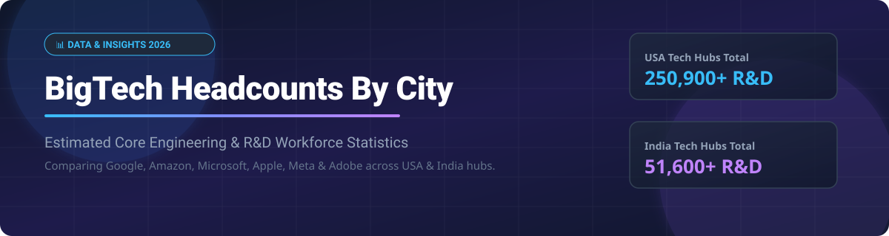

  

  
  
  
  
  

# 🏢 BigTech Headcounts By City 📈

> **Comprehensive breakdown & analysis of estimated core engineering and R&D workforce distribution across major BigTech hubs in the USA 🇺🇸 and India 🇮🇳.**

---

## 📌 Overview

This repository provides updated estimations and data metrics on software engineering, product development, and R&D headcounts across leading technology enterprises — including **Google**, **Amazon**, **Microsoft**, **Apple**, **Meta**, and **Adobe**.

Whether you are analyzing tech talent density, regional hiring trends, or evaluating major tech hubs for career growth and compensation benchmarks, this dataset offers regional insights into engineering capital.

---

## 🇺🇸 USA Tech Hubs: Estimated Core Engineering & R&D 🚀

| Tech Hub Region 📍 | Google 🔍 | Amazon 📦 | Microsoft 💻 | Apple 🍎 | Meta ♾️ | Adobe 🎨 | Row Total 📊 |
| :--- | :---: | :---: | :---: | :---: | :---: | :---: | :---: |
| **San Francisco Bay Area, CA** *(SF/Silicon Valley)* 🌉 | 28,000+ | 8,000+ | 4,500+ | 32,000+ | 22,000+ | 7,000+ | **101,500+** |
| **Greater Seattle, WA** *(Puget Sound)* 🌲 | 6,500+ | 35,000+ | 38,000+ | 2,500+ | 6,000+ | 1,000+ | **89,000+** |
| **New York City Metro, NY** *(Manhattan)* 🗽 | 7,500+ | 4,500+ | 2,000+ | 1,000+ | 5,000+ | 800+ | **20,800+** |
| **Austin, TX** *(Silicon Hills)* 🤠 | 1,800+ | 2,500+ | 1,200+ | 5,000+ | 1,200+ | 300+ | **12,000+** |
| **Greater Boston, MA** *(AI/Robotics)* 🎓 | 2,200+ | 2,500+ | 2,000+ | 600+ | 1,500+ | 400+ | **9,200+** |
| **Washington, D.C. Metro** *(HQ2/NoVA)* 🏛️ | 800+ | 6,000+ | 1,800+ | 300+ | 500+ | 200+ | **9,600+** |
| **Southern California** *(LA/San Diego)* 🌴 | 2,000+ | 2,000+ | 800+ | 2,500+ | 1,200+ | 300+ | **8,800+** |
| **Column Total** 📈 | **48,800+** | **60,500+** | **50,300+** | **43,900+** | **37,400+** | **10,000+** | **250,900+** |

---

## 🇮🇳 India Tech Hubs: Estimated Core Engineering & R&D 💡

| Tech Hub Region 📍 | Google 🔍 | Amazon 📦 | Microsoft 💻 | Apple 🍎 | Meta ♾️ | Adobe 🎨 | Row Total 📊 |
| :--- | :---: | :---: | :---: | :---: | :---: | :---: | :---: |
| **Bengaluru, KA** *(Primary R&D)* 🌆 | 4,000+ | 6,500+ | 3,000+ | 1,000+ | ~100 | 2,500+ | **17,100+** |
| **Hyderabad, TS** *(IDC Infrastructure)* 🏰 | 1,000+ | 8,000+ | 13,000+ | 1,500+ | ~150 | — | **23,800+** |
| **NCR** *(Noida/Gurugram)* 🏙️ | — | — | 1,000+ | — | — | 3,500+ | **4,500+** |
| **Pune, MH** *(Cloud/Infra)* ⛰️ | 400+ | 2,000+ | 400+ | — | — | — | **2,800+** |
| **Chennai, TN** *(Global Delivery)* 🌊 | — | 3,000+ | 300+ | 100+ | — | — | **3,400+** |
| **Column Total** 📈 | **5,400+** | **19,500+** | **17,700+** | **2,600+** | **~250** | **6,000+** | **~51,450+** |

---

## 🌟 Other Open-Source Projects

1. **[Velocity](https://github.com/ishandutta2007/Velocity)**  - Opensource equivalent of Google's Antigravity/Claude Code/Cursor.
2. **[Top-AI-repos](https://github.com/ishandutta2007/Top-AI-repos)**  - 193 most popular open source AI projects.
3. **[Awesome-Text-to-Speech](https://github.com/ishandutta2007/Awesome-Text-to-Speech)**  - A curated list of tools, models, and resources in the Text-to-Speech sector.
4. **[Open-Laudable](https://github.com/ishandutta2007/Open-Laudable)**  - Opensource alternative of Lovable.
5. **[ultimate-watermark-remover-gui](https://github.com/ishandutta2007/ultimate-watermark-remover-gui)**  - GUI for Watermark Remover for video or image using multiple open-source models.
6. **[Awesome-Image-Generation](https://github.com/ishandutta2007/Awesome-Image-Generation)**  - Open-source Image Generation AI tools.
7. **[FasterClaw](https://github.com/ishandutta2007/FasterClaw)**  - Faster OpenClaw: Open-source autonomous personal AI assistant.
8. **[Video-Generation-Landscape](https://github.com/ishandutta2007/Video-Generation-Landscape)**  - Open-source AI video tools to generate text-to-video or image-to-video.
9. **[Awesome-Claw](https://github.com/ishandutta2007/Awesome-Claw)**  - Open-source Open Claw like projects.
10. **[open-cowork](https://github.com/ishandutta2007/open-cowork)**  - An open-source alternative to Claude Cowork, powered by OpenCode.

---

## 💖 Support & Community

Thank you for visiting and using this resource! If you find this data helpful for your market research, career planning, or general insights, please consider supporting the project:

- 🌟 **Star this repository** to show your support and help others discover it!
- 🍴 **Fork it** to contribute updated numbers or extend analysis to other tech hubs.
- 📢 **Share it** with your network, colleagues, or tech communities.
- ☕ **Buy me a coffee / Sponsor:** Support ongoing maintenance via the [GitHub Sponsor Dashboard](https://github.com/sponsors/ishandutta2007).

---

## 📈 Star History

